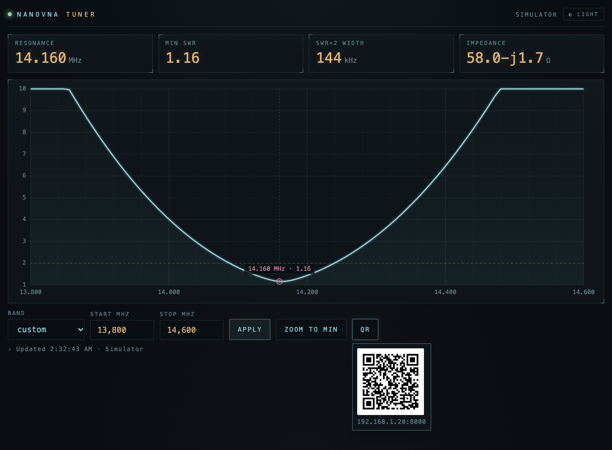
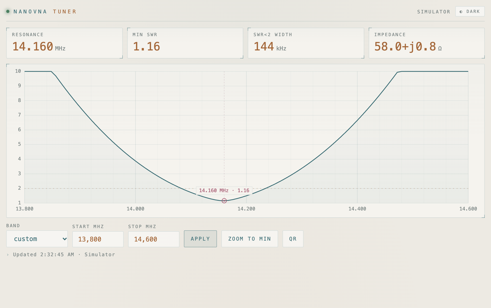
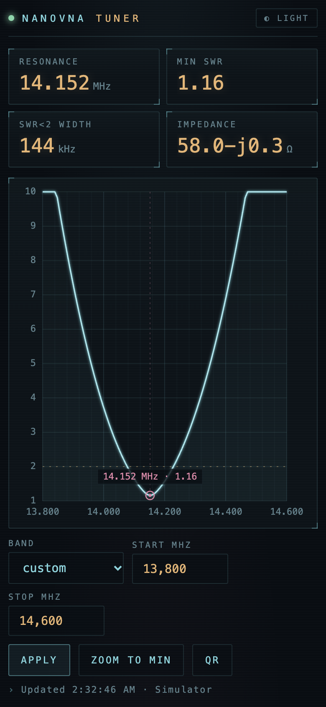
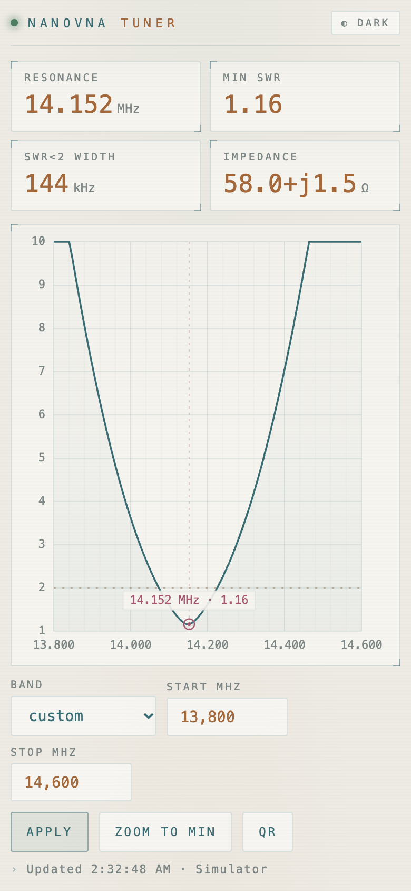
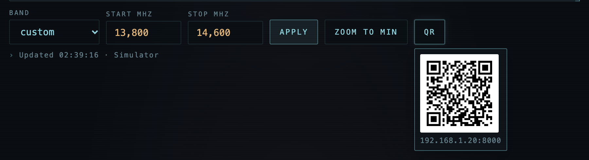

# nanovna-tuner

Shows your NanoVNA's SWR measurements live on your phone: resonance frequency, minimum SWR, SWR < 2 bandwidth, impedance and the SWR curve.

Works with NanoVNA / ‑H / ‑H4 and NanoVNA V2 (SAA‑2 / SAA‑2N) / V2 Plus4 / LiteVNA. The device is detected automatically and can be plugged in at any time.

| Dark (QR code for the phone opened) | Light |
|---|---|
|  |  |

| Phone, dark | Phone, light |
|---|---|
|  |  |

## Download

| System | Latest release |
|---|---|
| macOS (Apple Silicon) | [nanovna-tuner-macos-arm64](https://github.com/akarpf/nanovna-tuner/releases/latest/download/nanovna-tuner-macos-arm64) |
| Windows | [nanovna-tuner-windows-x64.exe](https://github.com/akarpf/nanovna-tuner/releases/latest/download/nanovna-tuner-windows-x64.exe) |
| Linux | [nanovna-tuner-linux-x64](https://github.com/akarpf/nanovna-tuner/releases/latest/download/nanovna-tuner-linux-x64) |

Run it from a terminal (first start takes a few seconds):

```sh
# macOS – once: allow the unsigned file
xattr -d com.apple.quarantine nanovna-tuner-macos-arm64 && chmod +x nanovna-tuner-macos-arm64
./nanovna-tuner-macos-arm64

# Windows – allow private network access when the firewall asks
.\nanovna-tuner-windows-x64.exe

# Linux – once: allow serial port access, then log out and in
sudo usermod -aG dialout $USER && chmod +x nanovna-tuner-linux-x64
./nanovna-tuner-linux-x64
```

Open `http://localhost:8000` on the computer, tap **QR** and scan the code with your phone (same Wi‑Fi). Stop with Ctrl+C.



## Options

| Option | Default | |
|---|---|---|
| `--start` / `--stop MHZ` | `1` / `30` | Initial sweep range (also adjustable on the page) |
| `--points N` | `101` | Points per sweep (11–1024); more = finer but slower |
| `--simulate` | | Test without hardware |
| `--port PORT` | auto | Serial port, if auto-detection picks the wrong device |
| `--http-port N` | `8000` | Web server port |
| `--host ADDR` | `0.0.0.0` | `127.0.0.1` = this computer only |
| `--url URL` | auto | Phone address, if the detected one is wrong (VPN etc.) |
| `--tray` | | Tray / menu-bar icon |

Tip: rather than raising `--points`, use a band preset or **Zoom to min** to see a sharp resonance in detail.

## Calibration (NanoVNA V2 only)

The V2 sends uncalibrated data over USB, so the page shows **Open / Short / Load**: set the range, connect each standard at the end of your cable and tap its button. The calibration is saved and reused; redo it for a wider range or a different cable.

## Security

Your phone gets access via a token in the QR code. Meant for your home network only (plain HTTP). Calibration and token are stored in `~/.nanovna-tuner/`.

## Development

```sh
uv run python -m nanovna_tuner --simulate   # run from source
uv run python -m pytest                     # tests
uv run ruff check . && uv run ruff format . # lint + format
```

Release: bump `__version__` in `nanovna_tuner/__init__.py`, then push a matching tag (`git tag v0.2.1 && git push origin v0.2.1`). GitHub builds the executables.

## License

© 2026 Andreas Karpf – [GPL‑3.0‑or‑later](LICENSE). Free to use, share and modify; distributed versions must stay open source. No warranty.
